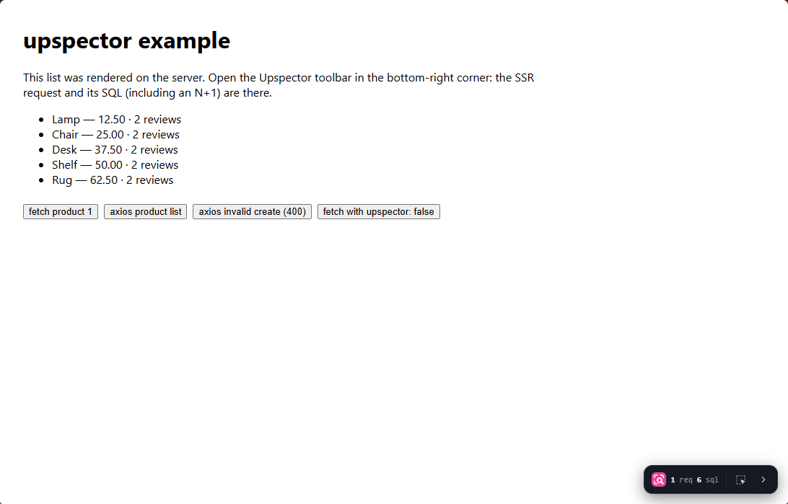

<div align="center">


# Upspector

**A debug overlay that shows backend data for each request.**

Upspector works with NestJS backends and React or Next.js frontends.<br />
It shows SQL, outbound HTTP, cache calls, logs and timings for each request.<br />
It works in the browser and during server-side rendering (SSR).

[Quick start](#quick-start) · [Documentation](docs/content/docs/index.mdx) · [Example apps](examples) · [License](#license)

<br />



</div>

## Overview

The backend records data for each request and sends it with the response.
A toolbar in your app shows this data.
Use it to find slow requests, see their queries and find N+1 problems.

## Features

| Feature | Description |
| --- | --- |
| Database | Shows each SQL statement with its parameters, duration and source line. Marks repeated queries as a possible N+1. Supports Prisma and Drizzle. |
| Requests | Shows SSR and browser requests from `fetch` or axios, with headers and bodies. |
| Timers | Shows the duration of each step in the handler on a timeline. |
| Render profiling | Shows the duration and memory use of a Next.js server render. |
| Cache, HTTP and logs | Shows ioredis calls, outbound HTTP calls and the logs of the request. |
| Element inspector | Select an element on the page to see its source and its backend requests. |
| MCP for agents | Coding agents can read the same data. |
| Secret masking | Removes tokens, passwords and cookies before the overlay shows the data. |

<table>
  <tr>
    <td width="50%"></td>
    <td width="50%"></td>
  </tr>
  <tr>
    <td align="center"><sub>Every request, with source, route and handler</sub></td>
    <td align="center"><sub>Handler timings on a timeline</sub></td>
  </tr>
</table>

## Quick start

### 1. Set up the backend (NestJS)

Install the package:

```bash
pnpm add @uplide/upspector-nest
```

Add the module:

```ts
NestUpspectorModule.forRoot({ enabled: process.env.APP_DEBUG === "true" });
```

For the middleware and the Prisma, Drizzle, ioredis and axios integrations, refer to the [backend guide](docs/content/docs/backend/index.mdx).

### 2. Set up the frontend (Next.js)

Run the CLI in your Next.js app:

```bash
pnpm dlx @uplide/upspector-cli init
```

To see the changes before the CLI applies them, add `--dry-run`.
For plain React, refer to the [React guide](docs/content/docs/frontend/react.mdx).

### 3. Open the overlay

Start your app. Click the Upspector logo in the bottom-right corner.

> [!WARNING]
> The overlay shows SQL text and parameters. Do not enable Upspector on a production deployment that users can access.

## Example apps

The repository contains a NestJS API and a Next.js app. Upspector is set up in both apps.

1. Install and build:

   ```bash
   pnpm install && pnpm build
   ```

2. Create the database:

   ```bash
   pnpm --filter example-nest-api db:push
   ```

3. Start the API in terminal 1:

   ```bash
   APP_DEBUG=true pnpm example:api
   ```

4. Start the web app in terminal 2:

   ```bash
   NEXT_PUBLIC_UPSPECTOR=true pnpm example:web
   ```

5. Open <http://localhost:4200>.

The product list has an N+1 problem. The Database tab shows it.

## Packages

| Package | Description |
| --- | --- |
| `@uplide/upspector-nest` | Records request data in a NestJS backend. |
| `@uplide/upspector-next` | Integrates with the Next.js App Router. |
| `@uplide/upspector` | Contains the overlay and the `fetch` and axios capture. |
| `@uplide/upspector-cli` | Adds the `upspector init` command for Next.js projects. |
| `@uplide/upspector-protocol` | Contains the types that the backend and frontend share. |

## Documentation

- [How it works](docs/content/docs/how-it-works.mdx)
- [Backend options and integrations](docs/content/docs/backend/options.mdx)
- [Next.js setup](docs/content/docs/frontend/nextjs.mdx)
- [axios](docs/content/docs/frontend/axios.mdx)
- [Redaction](docs/content/docs/frontend/redaction.mdx)
- [Element inspector](docs/content/docs/frontend/inspector.mdx)
- [MCP for agents](docs/content/docs/frontend/mcp.mdx)
- [Configuration reference](docs/content/docs/reference/config.mdx)

To run the documentation site on your computer, run `pnpm docs:dev`.

## Contributing

Run these commands before you open a pull request:

```bash
pnpm install
pnpm build
pnpm typecheck
pnpm test
```

For more information, refer to [Development](docs/content/docs/development.mdx).

## About Uplide

Upspector is built and maintained by [Uplide](https://uplide.com), a software
engineering company based in London and Istanbul. We work in small,
product-focused teams on AI consulting, MVP and product development, cloud and
DevOps, and software consulting — with 50+ projects shipped for clients in 9
countries.

Have a project in mind? Visit **[uplide.com](https://uplide.com)**.

## License

[Apache License 2.0](LICENSE)
