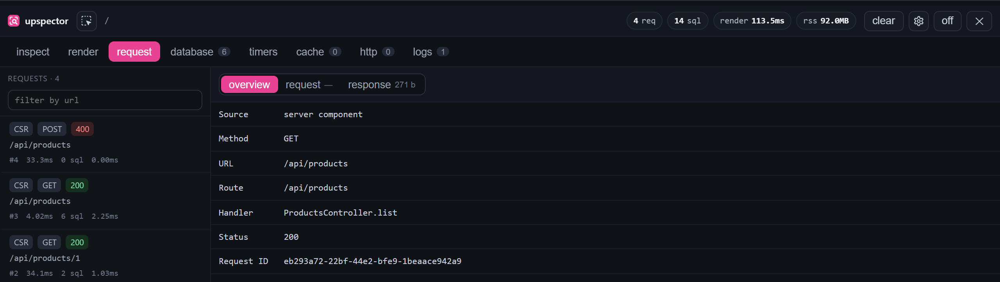
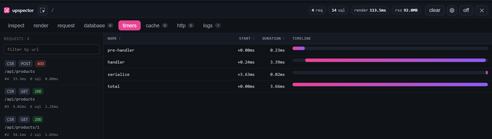

<div align="center">


# Upspector

**See what your backend did — right next to the page that asked for it.**

A per-request debug overlay for NestJS backends and React / Next.js frontends.<br />
SQL, outbound HTTP, cache, logs and timings for every request, in the browser and during SSR.

[Quick start](#quick-start) · [Documentation](docs/content/docs/index.mdx) · [Example apps](examples) · [License](#license)

<br />

</div>

## Why Upspector?

Your frontend shows a slow page. Which request was it? Which queries did it run?
Was that an N+1? Upspector answers that without leaving the browser: the backend
attaches what it measured to each response, and a small toolbar in the corner of
your app shows it.

## Features

- 🗄️ **Database** — every SQL statement with parameters, timing and the line that ran it. Repeated queries are flagged as a possible N+1. Works with Prisma and Drizzle.
- 🌐 **Requests** — SSR and browser requests side by side, from `fetch` or axios, with headers and bodies.
- ⏱️ **Timers** — where the time went inside the handler, on a timeline.
- 🧩 **Render profiling** — how long a Next.js server render took and what it cost in memory.
- 📦 **Cache, HTTP & logs** — ioredis calls, outbound HTTP from the backend, and the logs written during the request.
- 🎯 **Element inspector** — pick something on the page and see its source and the backend requests behind it.
- 🤖 **MCP for agents** — coding agents can read the same data while they drive the browser.
- 🔒 **Secrets masked** — tokens, passwords and cookies are redacted before they reach the overlay.

<table>
  <tr>
    <td width="50%"></td>
    <td width="50%"></td>
  </tr>
  <tr>
    <td align="center"><sub>Every request, with source, route and handler</sub></td>
    <td align="center"><sub>Handler timings on a timeline</sub></td>
  </tr>
</table>

## Quick start

**1. Backend (NestJS)**

```bash
pnpm add @uplide/upspector-nest
```

```ts
NestUpspectorModule.forRoot({ enabled: process.env.APP_DEBUG === "true" });
```

See the [backend guide](docs/content/docs/backend/index.mdx) for the middleware and the Prisma, Drizzle, ioredis and axios integrations.

**2. Frontend (Next.js)**

```bash
pnpm dlx @uplide/upspector-cli init
```

The CLI sets everything up in your Next.js app. Add `--dry-run` to preview the changes first.
Using plain React? See the [React guide](docs/content/docs/frontend/react.mdx).

**3. Open your app** and click the Upspector logo in the bottom-right corner.

> [!WARNING]
> The overlay shows SQL text and bound parameters. Never enable Upspector on a production deployment that real users can reach.

## Try the example

The repository includes a NestJS API and a Next.js app that are already wired up.

```bash
pnpm install && pnpm build
pnpm --filter example-nest-api db:push
APP_DEBUG=true pnpm example:api              # terminal 1
NEXT_PUBLIC_UPSPECTOR=true pnpm example:web   # terminal 2
```

Open <http://localhost:4200>. The product list contains a deliberate N+1 — the Database tab will point it out.

## Packages

| Package | What it does |
| --- | --- |
| `@uplide/upspector-nest` | Collects request data in a NestJS backend |
| `@uplide/upspector-next` | Next.js App Router integration |
| `@uplide/upspector` | The overlay and the `fetch` / axios capture |
| `@uplide/upspector-cli` | `upspector init` for Next.js projects |
| `@uplide/upspector-protocol` | Shared types between backend and frontend |

## Documentation

- [How it works](docs/content/docs/how-it-works.mdx)
- [Backend options and integrations](docs/content/docs/backend/options.mdx)
- [Next.js setup](docs/content/docs/frontend/nextjs.mdx) · [axios](docs/content/docs/frontend/axios.mdx) · [Redaction](docs/content/docs/frontend/redaction.mdx)
- [Element inspector](docs/content/docs/frontend/inspector.mdx) · [MCP for agents](docs/content/docs/frontend/mcp.mdx)
- [Configuration reference](docs/content/docs/reference/config.mdx)

Run the docs site locally with `pnpm docs:dev`.

## Contributing

```bash
pnpm install
pnpm build
pnpm typecheck
pnpm test
```

See [Development](docs/content/docs/development.mdx) for more.

## License

[Apache License 2.0](LICENSE)
